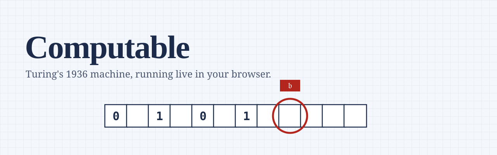

<picture>
  <source media="(prefers-color-scheme: dark)" srcset="docs/assets/banner-dark.svg">
  
</picture>

**Computable** is a web app for learning the Turing machine by running one. You write the rules,
press Run, and watch the head read, write and move, one square at a time. Every step is explained
in a plain sentence.

> **Status: being rebuilt.** This repo held a 2016 capstone project built with jQuery. It is now
> becoming Computable, release by release. Nothing below is live yet unless its status says so.
> The 2016 version will stay available at the git tag `v1.0-tcc-2016`.

---

## The story it tells

In **1936**, Alan Turing published *On Computable Numbers, with an Application to the
Entscheidungsproblem*. To answer a question about the limits of mathematics, he imagined a person
computing on paper divided into squares, and reduced that person to a machine: a tape, a head, and
a table of rules. That imagined machine is the Turing machine. Nobody built it. It is a model of
what any computer can and cannot do.

In **1940**, Turing and Gordon Welchman designed the **Bombe** at Bletchley Park, building on the
Polish *bomba* of Marian Rejewski. The Bombe was a real electromechanical machine. It searched
Enigma rotor settings against a *crib*, a guessed piece of the message such as `WETTERVORHERSAGE`
("weather forecast").

The two are often mixed up. Computable keeps them apart and shows how they connect: you will
encrypt a message on a working Enigma, break it with the Bombe, and then learn why a Turing
machine could do the same work.

## Roadmap

| Release | What you get | Status |
| --- | --- | --- |
| **R1** | The simulator, the guided tour, 5 languages, light and dark themes, About, Support the dev | In design |
| **R2** | Lessons: the formal definition, the Entscheidungsproblem, the halting problem, Church–Turing, the universal machine, and Turing's 1936 paper read alongside a running tape. Quizzes. | Planned |
| **R3** | Enigma lab: a working Enigma I with plugboard, real and practice messages | Planned |
| **R4** | Bombe lab: break your own Enigma message with a crib and a wall of drums | Planned |
| **R5** | The naval Enigma M4, then optional accounts | Planned |

## What R1 brings

- **A tape you can watch.** The head carries its current state. A sentence under the tape explains
  each step: *"In q1 reading 1: write 0, move left, go to q1."*
- **Rules, diagram and tape stay linked.** The rule in use lights up in the table, on the state
  diagram, and at the head at the same time.
- **Run, Step, and Step back.** Go backwards through a run. A step limit catches machines that
  never stop.
- **Two notations.** Modern rules (write, move, next state) and Turing's own 1936 notation, with his
  first machine as a built-in example.
- **One-sided or two-way tape**, chosen per machine.
- **Save and share.** Machines save in your browser, download as JSON, and share as a link.
  Machines from the 2016 version import directly.
- **A guided tour** that asks you to press Step, not just read about it.
- **Keyboard first.** `Space` runs, `→` steps, `←` steps back, `?` lists every shortcut.
- **English, Português (Brasil), Español, Français, Deutsch.** The app picks your browser's
  language and lets you switch back.
- **Squared paper by day, night paper by night.** Follows your system theme.

## The machine format

A machine is a small JSON file. This one adds 1 to a binary number:

```json
{
  "format": "computable/machine@1",
  "name": "Binary +1",
  "tape": "one-sided",
  "blank": "_",
  "start": "q0",
  "accept": ["qA"],
  "reject": ["qR"],
  "input": "1011",
  "rules": [
    { "state": "q0", "read": "0", "write": "0", "move": "R", "next": "q0" },
    { "state": "q0", "read": "1", "write": "1", "move": "R", "next": "q0" },
    { "state": "q0", "read": "_", "write": "_", "move": "L", "next": "q1" },
    { "state": "q1", "read": "1", "write": "0", "move": "L", "next": "q1" },
    { "state": "q1", "read": "0", "write": "1", "move": "S", "next": "qA" },
    { "state": "q1", "read": "_", "write": "1", "move": "S", "next": "qA" }
  ]
}
```

Input `1011` ends as `1100` and the machine accepts.

## Built with

Next.js and TypeScript, Tailwind CSS, next-intl for languages, MDX for lessons, React Flow for the
state diagram, Motion for animation. The Turing machine, Enigma and Bombe logic live in plain
TypeScript with no UI code, tested with Vitest and Playwright. Hosted on Vercel.

## Where this came from

Computable started as the capstone project *Simulador de Máquina de Turing: Uma Aplicação Web para
o Aprendizado*, by **Wellmmer Lucas de Oliveira Pinto**, Bachelor of Computer Science at **UNASP**,
2016, advised by **Prof. Laercio Martins Carpes**.

In that study, 29 people used the 2016 app and answered a survey. 41.4% knew nothing about Turing
or his machine before. Afterwards, 79.3% reported they had learned something about it. The paper's
own list of future work (step back, a state diagram, a "stay" move, saving machines, better
animation) is the starting point for R1.

## Support

Computable is free and has no ads. A "Buy the dev a coffee" page arrives with R1.

## License

The code is under the [MIT License](LICENSE). Lesson texts and other written content are under
[CC BY 4.0](https://creativecommons.org/licenses/by/4.0/).
